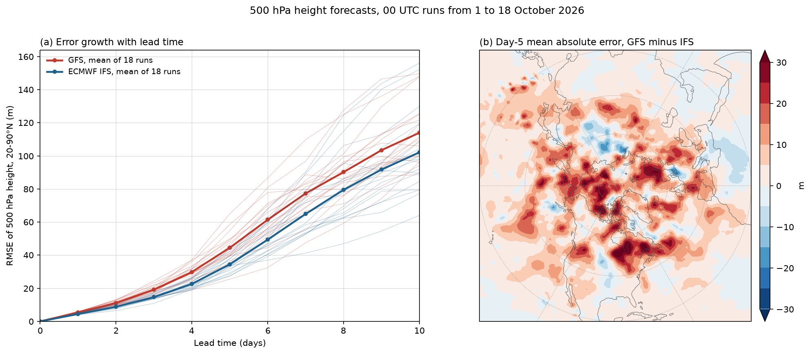

# fastgrib

[](https://github.com/Rochy111/fastgrib/actions/workflows/tests.yml)
[](https://rochy111.github.io/fastgrib/)

fastgrib decodes GRIB2 and GRIB1 files into numpy arrays. It runs on every
CPU core with numba, or on an NVIDIA GPU with cupy, and the values it
returns are bit-for-bit those of wgrib2. It reads local files, bytes and
remote URLs, regrids fields, exposes keys under ecCodes' names, and writes
GRIB2.

**Documentation:** https://rochy111.github.io/fastgrib/



## Installation

```bash
pip install git+https://github.com/Rochy111/fastgrib@v0.2.1
fastgrib -warm               # compile the decoders once, 20 to 30 s
```

Python 3.9 or later, on Linux, Windows or macOS. numpy and numba are the
only requirements. The `all` extra adds GPU decoding (cupy), xarray and
NetCDF output, and pyproj.

## Usage

```python
import fastgrib

f = fastgrib.open('gfs.t00z.pgrb2.0p25.f006')    # a path, an http(s):// or s3:// URL, or bytes
print(f)                                         # the inventory, as wgrib2 -s prints it
t2m = f.read('TMP:2 m above ground')             # (ny, nx) float32, NaN where undefined
z500 = f.read(name='HGT', level=500)             # pygrib-style keywords
tp = f.read(short_name='tp')                     # or ecCodes short names
lat, lon = f.latlon()                            # rows run south to north
u, v = f.winds(level=850)                        # east and north components
ds = f.to_xarray()                               # all fields as an xarray Dataset
f.write('subset.grib2', name='TMP')              # selected fields, as GRIB2
```

Given a URL, fastgrib reads the index published next to the file and
downloads only the fields that are read.

| Area | Coverage |
|---|---|
| Sources | GFS, GEFS, HRRR, NAM, RAP, NBM, MRMS, ECMWF IFS and open data, GRIB1 archives such as NARR |
| Packing | Simple, complex, IEEE, JPEG2000, PNG, CCSDS, run-length, spherical harmonics |
| Grids | Lat-lon, Gaussian (regular and reduced), Lambert, polar stereographic, Mercator, rotated, space view, NCEP's E- and B-grids |
| Other | Remote reads by byte range, regridding, wind rotation, xarray, ecCodes keys, GRIB2 writing, a command-line tool |

## Performance

Milliseconds per field, decoding every field of a file (Intel i7-13700K,
WSL2):

| File | pygrib | wgrib2, 1 thread | fastgrib, 1 core | fastgrib, all cores |
|---|---:|---:|---:|---:|
| GFS 0.25°, complex packing | 7.32 | 2.67 | 1.25 | 0.28 |
| HAFS, complex packing with bitmaps | 23.8 | 5.02 | 2.93 | 0.47 |
| ECMWF IFS 0.25°, simple packing | 3.55 | 1.43 | 0.87 | 0.25 |
| ECMWF open data, CCSDS | 11.9 | 10.1 | 4.28 | 0.52 |
| RAP 13 km, JPEG2000 | 10.1 | 8.76 | 4.75 | 0.98 |

The [performance page](https://rochy111.github.io/fastgrib/speed/) covers
the GPU and how the measurements were made.

## Accuracy

Values match wgrib2 3.1.3 bit for bit on GFS, GEFS, NBM, MRMS and ECMWF
data, inventory lines match NOAA's `.idx` files, and keys match ecCodes'.
`pytest` repeats these checks against stored wgrib2 and ecCodes output
without needing either installed. See the
[accuracy page](https://rochy111.github.io/fastgrib/reference/accuracy/).

## Related projects

[fastplot](https://github.com/Rochy111/fastplot) draws maps and plots with
matplotlib's and cartopy's interface and is used for the pictures here.

## Contributing and licence

See [CONTRIBUTING.md](CONTRIBUTING.md) and the [changelog](CHANGELOG.md).
fastgrib is released under the MIT licence. The tables derived from ecCodes
are under the Apache License 2.0 ([LICENSE-ecCodes](LICENSE-ecCodes)), and
WMO's code table C-14 under the MIT licence
([LICENSE-WMO-CCT](LICENSE-WMO-CCT)). See [NOTICE](NOTICE).
