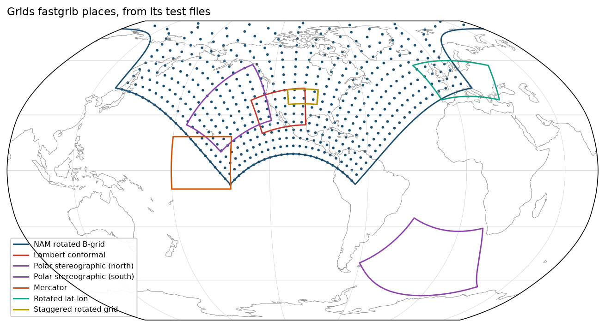

---
hide:
  - toc
---

# Gallery

Each example is a complete script with the figure it produces. The figures are drawn with [fastplot](https://rochy111.github.io/fastplot/) from fields read by fastgrib, and the scripts are in `docs/examples/`.

## Reading many files

<a class="card" href="model_verification/">

GFS and ECMWF verificationError growth over 18 days of forecasts

</a>
<a class="card" href="ensemble_sensitivity/">

Ensemble sensitivityWhich day-2 flow decides an uncertain day-5 forecast

</a>
<a class="card" href="hovmoller/">

Hovmöller diagram60 days of 250 hPa meridional wind

</a>

## Formats and grids

<a class="card" href="spectral/">

Spherical harmonic synthesisECMWF T63 surface temperature

</a>
<a class="card" href="grids/">

Test-file grid outlinesEvery projected grid in tests/data

</a>
<a class="card" href="speed_chart/">

Benchmark chartDecoding times against wgrib2 and pygrib

</a>

