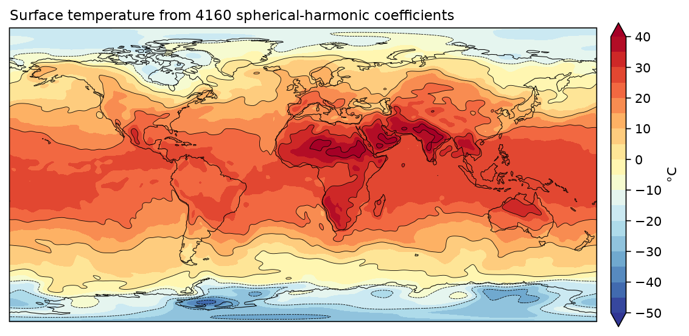

# Spherical harmonic synthesis

ECMWF's T63 surface temperature analysis, stored as 4,160 spherical-harmonic coefficients. wgrib2, ecCodes and pygrib return the coefficients; fastgrib can also synthesise the field at any points, here a 0.5° grid.



Data: ECMWF analysis for 12 UTC 24 April 2007, the sample ecCodes ships, in `tests/data/sh.grb2`.

```python title="docs/examples/spectral.py"
--8<-- "spectral.py"
```
