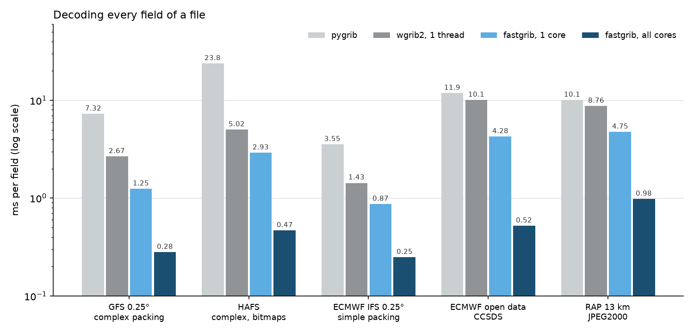

# Benchmark chart

Milliseconds per field to decode every field of five operational files.



Data: the measurements on the [performance page](../speed.md).

```python title="docs/examples/speed_chart.py"
--8<-- "speed_chart.py"
```
