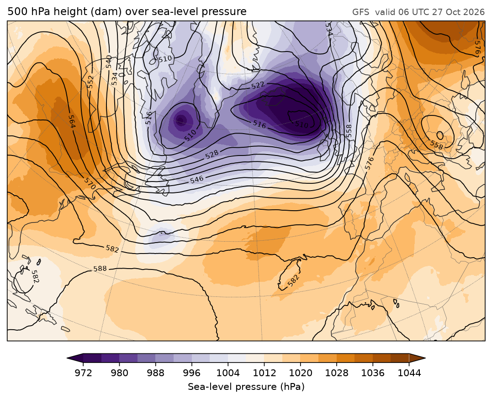

# fastgrib

fastgrib reads GRIB2 and GRIB1 files into numpy arrays, and writes them
back. It decodes on every CPU core with numba, or on an NVIDIA GPU with
cupy, and every value it returns is **bit-for-bit what wgrib2 gives**.

Decoding a whole GFS 0.25° file takes about 0.3 ms a field on a desktop
CPU, roughly ten times faster than wgrib2 on one thread and 25 times faster
than pygrib.

<figure markdown>

<figcaption>Two fields fetched by fastgrib from NOAA's GFS archive over HTTP,
1.8 MB of a 500 MB file, and drawn with
<a href="https://rochy111.github.io/fastplot/">fastplot</a>.</figcaption>
</figure>

## What it does

- **Reads anything you're likely to meet.** GFS, GEFS, HRRR, NAM, RAP, NBM,
  MRMS, ECMWF IFS and open data, and older GRIB1 archives such as NARR.
  Every common packing is supported: simple, complex, IEEE, JPEG2000, PNG,
  CCSDS and run-length.
- **Picks fields like the tools you know.** `wgrib2 -match` regular
  expressions, pygrib-style keywords, or ecCodes short names.
- **Reads remote files cheaply.** Give it a URL and it fetches only the
  fields you ask for, using the index published beside the file.
- **Puts fields on a grid.** Regrid to lat-lon, to another file's grid or
  to points, with winds turned to east and north.
- **Writes GRIB2.** Subsets, edited metadata and newly packed values, which
  wgrib2 and ecCodes read back.
- **Matches the references.** Values match wgrib2's and keys match ecCodes',
  checked across thousands of fields.

## In a few lines

```python
import fastgrib

f = fastgrib.open('gfs.t00z.pgrb2.0p25.f006')    # a path, an http(s):// or s3:// URL, or bytes
print(f)                                         # the inventory, as wgrib2 -s lists it
t2m = f.read('TMP:2 m above ground')             # (ny, nx) float32, NaN where undefined
z500 = f.read(name='HGT', level=500)             # pygrib-style keywords
lat, lon = f.latlon()                            # rows south to north
ds = f.to_xarray()                               # every field as an xarray Dataset
```

[Get started](getting-started.md) to install it, or see the
[gallery](gallery.md) for complete scripts.

## How it compares

| | fastgrib | wgrib2 | pygrib / cfgrib |
|---|---|---|---|
| Values | wgrib2's, to the bit | the reference | ecCodes' |
| Speed, GFS 0.25° | 0.28 ms a field | 2.67 ms (one thread) | 7.32 ms |
| Installs with | pip (numpy, numba) | a compiled binary | ecCodes C library |
| Remote files | byte ranges, by index | no | no |
| GPU decoding | yes | no | no |
| Writes GRIB2 | yes | yes | yes (ecCodes) |

The [speed page](speed.md) has the full measurements.
