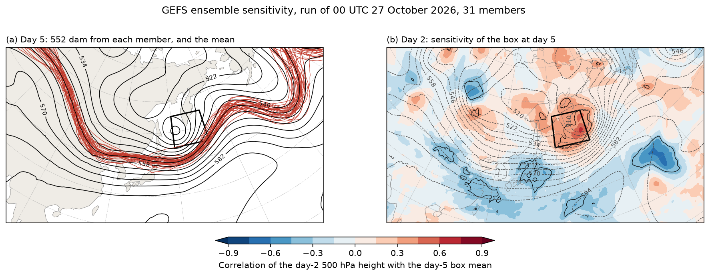

---
hide:
  - navigation
  - toc
---

<div class="home-hero" markdown>
<div markdown>

# fastgrib

<p class="lede">GRIB2 and GRIB1 decoding for Python. fastgrib reads files and
URLs into numpy arrays on every CPU core with numba, or on an NVIDIA GPU, and
every value is bit-for-bit what wgrib2 returns.</p>

<div class="install" markdown>

```bash
pip install git+https://github.com/Rochy111/fastgrib@v0.2.0
```

</div>

[Get started](getting-started.md){ .md-button .md-button--primary }
[Browse the gallery](gallery/index.md){ .md-button }

</div>
<div markdown>



</div>
</div>

<div class="facts">
<div><span class="num">0.28 ms</span><span class="what">per field to decode a whole GFS 0.25° file, using every core</span></div>
<div><span class="num">2.67 ms</span><span class="what">per field for wgrib2 on one thread, and 7.32 ms for pygrib</span></div>
<div><span class="num">1,486</span><span class="what">GFS fields checked against wgrib2, every value identical to the bit</span></div>
<div><span class="num">2</span><span class="what">required dependencies: numpy and numba</span></div>
</div>

## Overview

fastgrib opens GRIB files from disk, from memory or over HTTP, lists their
contents the way `wgrib2 -s` does, and returns fields as numpy arrays.
Fields can be selected with `wgrib2 -match` regular expressions, with
pygrib-style keywords or with ecCodes short names. It also regrids fields,
turns grid-relative winds to east and north, exposes every key under
ecCodes' names, and writes GRIB2.

It reads the data published by the main operational centres, including
GFS, GEFS, HRRR, NAM, RAP, NBM and MRMS from NOAA, IFS fields from ECMWF,
and GRIB1 archives such as NARR, in every common packing: simple, complex,
IEEE, JPEG2000, PNG, CCSDS and run-length.

## Example

```python
import fastgrib

f = fastgrib.open('gfs.t00z.pgrb2.0p25.f006')    # a path, an http(s):// or s3:// URL, or bytes
print(f)                                         # the inventory, as wgrib2 -s prints it
t2m = f.read('TMP:2 m above ground')             # (ny, nx) float32, NaN where undefined
z500 = f.read(name='HGT', level=500)             # pygrib-style keywords
lat, lon = f.latlon()                            # rows run south to north
u, v = f.winds(level=850)                        # east and north components
ds = f.to_xarray()                               # all fields as an xarray Dataset
```

Given a URL, fastgrib reads the index file published next to the data and
downloads only the fields that are read. The [gallery](gallery/index.md)
has complete scripts, drawn with [fastplot](https://rochy111.github.io/fastplot/).

## Compared with other readers

| | fastgrib | wgrib2 | pygrib |
|---|---|---|---|
| Decoded values | wgrib2's, to the bit | the reference | ecCodes' |
| GFS 0.25°, ms per field | 0.28 (all cores), 1.25 (one) | 2.67 (one thread) | 7.32 |
| Installation | pip; numpy and numba | compiled binary | pip; wheels include ecCodes |
| Remote files | byte ranges, using the index | no | no |
| GPU decoding | yes | no | no |
| Writes GRIB2 | yes | yes | through ecCodes |

The [performance page](speed.md) describes how these were measured.
