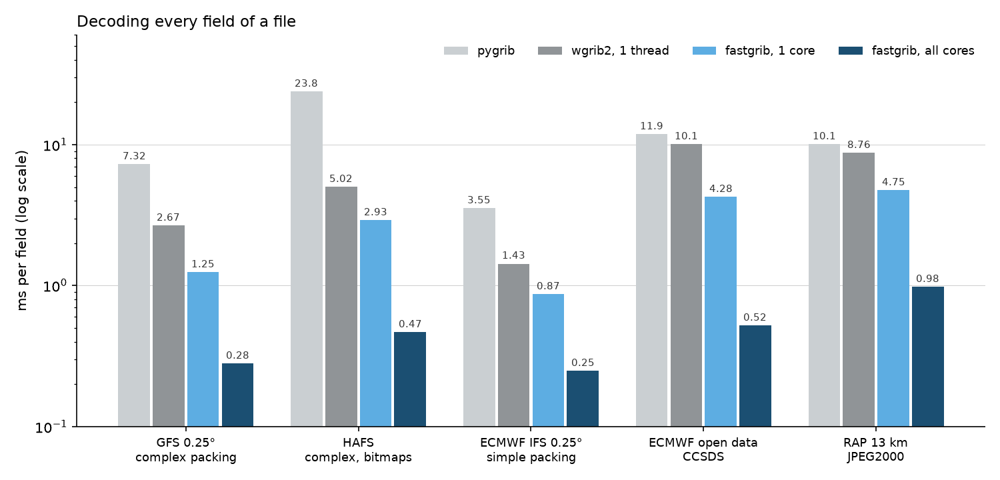

# Speed



## Operational files

Milliseconds per field, decoding every field of each file, on an i7-13700K
(8 performance and 8 efficiency cores) in WSL2. wgrib2 3.1.3 is run as
`-bin /dev/null` on one thread, since its OpenMP build is slower on 24
threads than on one for all of these. pygrib 2.1.6 reads `.values` of every
message.

| File | wgrib2, 1 thread | pygrib | fastgrib, 1 core | fastgrib, all cores | One field read alone, pygrib / fastgrib |
|---|---:|---:|---:|---:|---:|
| GFS 0.25°, 743 fields, complex packing | 2.67 | 7.32 | 1.25 | 0.28 | 11.2 / 1.1 |
| HAFS, 749 fields of 2.3M points, complex packing with bitmaps | 5.02 | 23.8 | 2.93 | 0.47 | 28.8 / 2.5 |
| ECMWF IFS 0.25°, 78 fields, simple packing | 1.43 | 3.55 | 0.87 | 0.25 | 2.9 / 1.3 |
| ECMWF open data, 157 fields, CCSDS | 10.1 | 11.9 | 4.28 | 0.52 | 11.8 / 4.8 |
| RAP 13 km, 355 fields, JPEG2000 | 8.76 | 10.1 | 4.75 | 0.98 | 11.9 / 2.1 |

Opening and listing GFS 0.25° takes 10 ms, against 141 ms for `wgrib2 -s`
and 1.28 s for pygrib.

## On the GPU

Milliseconds per field with an RTX 5070 Ti, against wgrib2 with OpenMP on
all 24 threads:

| File | wgrib2 | fastgrib CPU | GPU to numpy | GPU, left on the card |
|---|---:|---:|---:|---:|
| NBM CONUS, 769 fields of 3.7M points | 4.4 | 0.54 | 0.37 | 0.10 |
| GFS 0.25°, 743 fields of 1.04M points | 1.1 | 0.27 | 0.26 | 0.17 |
| GFS 0.5°, 743 fields of 260k points | 0.36 | 0.076 | 0.10 | 0.055 |

Copying back to numpy is limited by PCIe at about 50 GB/s, not by decoding,
and the CPU at full load is limited by memory bandwidth. A single NBM field
read alone takes 2.0 ms on the CPU (1.4 ms into a reused array) and 0.7 ms on
the GPU into a reused array.

## A new process

A script that starts, reads one field and exits pays for starting up as well
as for the field. Milliseconds in a fresh process on Windows (same machine),
the medians of 7 runs:

| File | First field, 0.3.0 | First field, 0.3.1 | Start to first values, 0.3.0 | 0.3.1 |
|---|---:|---:|---:|---:|
| GFS, simple packing | 759 | 4.0 | 913 | 158 |
| GFS, JPEG2000 | 853 | 11.6 | 1015 | 170 |
| GFS 0.25°, a 31 MB file | 800 | 10.1 | 954 | 162 |

Most of what is left is importing numpy (about 115 ms) and fastgrib (35 ms).
0.3.0 spent its first field starting numba; 0.3.1 runs the decoders from a
file linked once for your CPU (see [Internals](internals.md#the-kernel-image)).
Reading the rest of the 31 MB file then takes 55 ms rather than 71.

## One field at a time

A complex-packed field read alone is split across all cores, after one core
has scanned its groups for where to cut. 0.3.2 makes that scan three times
as fast. Milliseconds a field into a reused array, 40 fields from across
each file, the best of 4 passes on Windows (same machine):

| File | 0.3.1 | 0.3.2 |
|---|---:|---:|
| GFS flux, 3072 x 1536 Gaussian | 7.3 | 6.0 |
| HRRR surface, 1799 x 1059 | 1.6 | 1.1 |
| NAM CONUS nest | 1.55 | 1.25 |
| HAFS storm, 1001 x 801 | 0.74 | 0.62 |

Decoding a whole file is unchanged. Where fastgrib runs on numba instead of
its kernel image (see [Internals](internals.md#the-kernel-image)), 0.3.2 also
fixes a bit reader that was seven times slower than it should be there:
single reads take 40-58% less time and whole files 10-30% less.

## Measuring on your machine

```bash
python tools/bench.py FILE
python tools/time_files.py FILE ...
```

## How it works

The decoders are numba kernels that run without the GIL, one thread per
core, and read bits without branching. Fields too large for one core are
split across all of them in a single pass: runs of complex packing are
decoded from a zero starting state and then corrected, which works because
the spatial differencing is linear, and each thread takes the next run when
it finishes one, so slower cores simply do fewer.

On the GPU, each batch of fields is one CUDA graph: a scan for the spatial
differencing, a table of scale factors per field, a decode loop that keeps
each warp on the same path, and uploads and downloads overlapped on
separate streams. JPEG2000 and CCSDS are decoded by fastgrib's own
implementations, written for GRIB data rather than general images.
